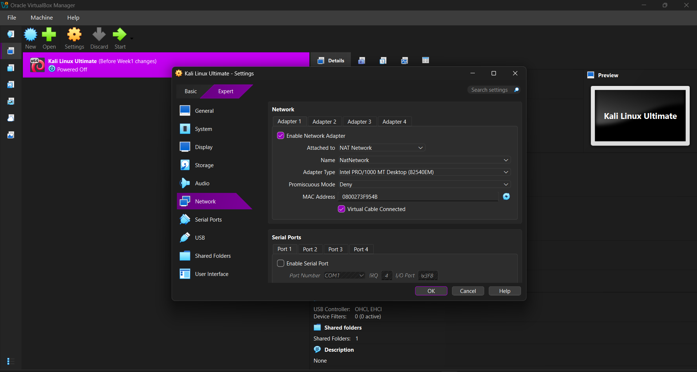
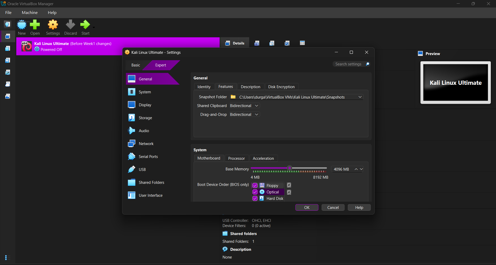
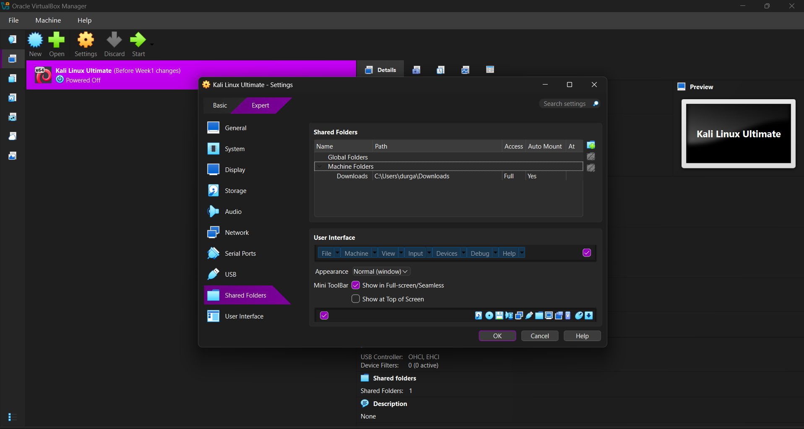
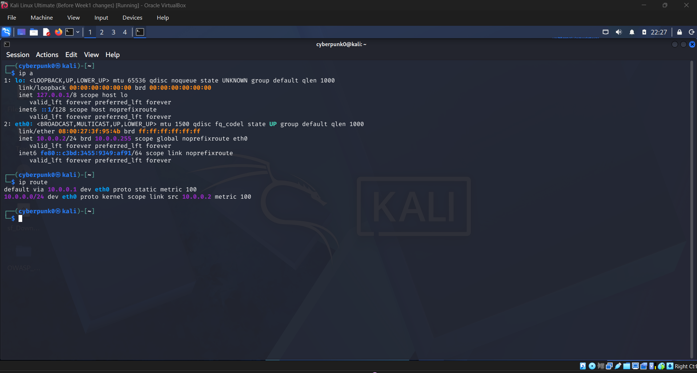
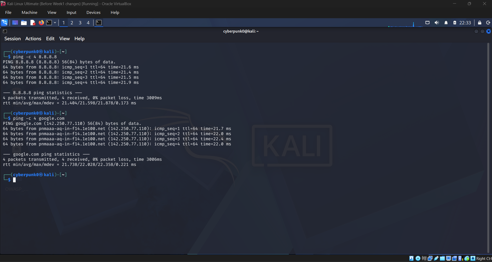
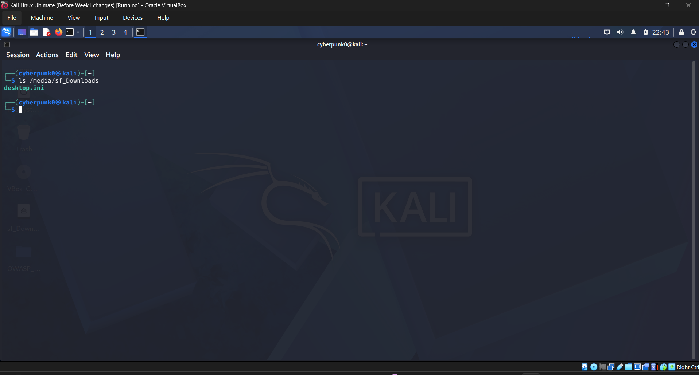
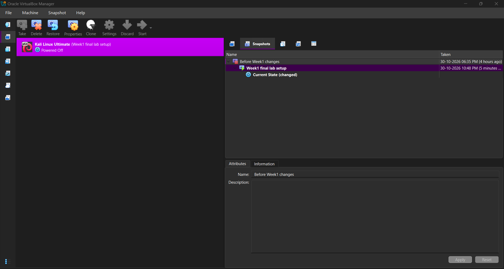

# Cybersecurity Lab Setup: VirtualBox and Kali Linux

Networkwalks Cybersecurity Internship | Week 1 | Project Module 1 (WK1-PM1) | Batch B084

Author: Durgaprasad Veesam

## Project Overview
This project sets up an isolated cybersecurity testing lab on my own laptop using VirtualBox and Kali Linux. The lab is built for learning penetration testing, vulnerability assessment and ethical hacking practice in a safe environment that I own.

## Objectives
- Install and configure VirtualBox as the virtualization platform
- Set up Kali Linux as the attacker machine
- Create a NAT Network in the subnet 10.0.0.0/24
- Assign Kali Linux a static IP address and confirm full internet access
- Enable shared clipboard, drag and drop and a shared folder
- Take a VM snapshot as a recovery point

## Lab Environment
| Item | Details |
|---|---|
| Host operating system | [Windows 11] |
| Hypervisor | Oracle VirtualBox [7.2.20 r175154] |
| Guest operating system | Kali Linux |
| Network type | NAT Network (NatNetwork) |
| Subnet | 10.0.0.0/24 |
| Kali Linux IP address | 10.0.0.2/24 |
| Gateway | 10.0.0.1 |
| DNS server | 8.8.8.8 |
| RAM and CPU for VM | [4 GB RAM, 2 CPU cores] |

## Requirements Checklist
- [x] VirtualBox installed (latest version)
- [x] Kali Linux imported as the attacker machine
- [x] NAT Network created with 10.0.0.0/24
- [x] Shared clipboard and drag and drop enabled
- [x] Shared folder enabled (Downloads folder from the host)
- [x] Kali Linux IP address set to 10.0.0.2/24
- [x] Kali Linux has full internet access
- [x] Snapshot taken

## Steps Performed

### Step 1. Install VirtualBox
I installed the latest VirtualBox from the official website and confirmed the version.


### Step 2. Create the NAT Network
In File, Tools, Network, NAT Networks, I created NatNetwork with the IPv4 prefix 10.0.0.0/24 and DHCP enabled. A NAT Network lets all lab virtual machines talk to each other and also reach the internet.


### Step 3. Configure the Kali Linux VM network
I set Adapter 1 of the Kali VM to NAT Network and selected NatNetwork.



### Step 4. Enable clipboard and drag and drop
I set Shared Clipboard and Drag'n'Drop to Bidirectional in the VM General Advanced settings.



### Step 5. Enable the shared folder
I shared the Downloads folder of the host with Full access and auto-mount enabled.



### Step 6. Set a static IP address in Kali Linux
In Edit Connections, Wired connection 1, IPv4 Settings, I used Manual mode with address 10.0.0.2, netmask 24, gateway 10.0.0.1 and DNS 8.8.8.8.


### Step 7. Verify the network
I confirmed the IP address and route, then tested internet access with ping to an IP address and to a domain name.

```bash
ip a
ip route
ping -c 4 8.8.8.8
ping -c 4 google.com
```




### Step 8. Verify the shared folder
I confirmed that the shared Downloads folder is visible inside Kali Linux.



### Step 9. Take a snapshot
I took a snapshot of the finished lab so I can restore it if something breaks later.



## Troubleshooting
Problem: [Write your real problem here. Example: Kali had no internet after I set the static IP.]

Solution: [Write what you did. Example: I disabled the duplicate address detection timeout and restarted the connection:]

```bash
sudo nmcli connection modify "Wired connection 1" ipv4.dad-timeout 0
sudo nmcli connection down "Wired connection 1"
sudo nmcli connection up "Wired connection 1"
```

Result: [Internet worked after the restart.]

## Skills Demonstrated
Virtualization, VirtualBox, Kali Linux, NAT Network configuration, static IP configuration, TCP/IP networking, DNS, network troubleshooting, Linux command line, nmcli, VM snapshots, technical documentation.

## What I Learned
- How a NAT Network lets virtual machines share one private subnet and the internet
- How to set a static IP address, gateway and DNS in Kali Linux
- How to test connectivity with ping and verify routes
- How snapshots protect a lab before risky experiments

## Legal Notice
This lab is for education only. All testing is done in my own isolated lab environment.
